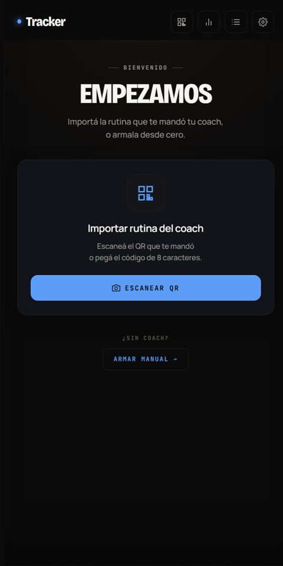

# JuvenFit Tracker

Mobile-first workout tracker for JuvenFit athletes: follow the routine your coach assigns, log every set, and sync sessions back to the coach.

**Live app:** https://jhk212.github.io/JuvenFit-Tracker/



## Features

- **Coach routine import**: scan a QR code (camera + jsQR) or enter an 8-character code to load the routine assigned by the coach; the device is paired to the athlete without a password.
- **Guided workout mode**: swipeable exercise carousel, per-set logging of weight and reps, RIR effort bar, persistent rest timer, and suggested load based on the previous session.
- **Block-based days**: mobility + core, main, accessory, finisher and custom blocks, including supersets/tri-sets, dropsets, core circuits by round, AMRAP/EMOM interval timers and timed exercises.
- **Exercise swaps**: replace an exercise mid-workout "just today" or permanently in the routine; "Plaza" mode converts a gym day into a bodyweight version.
- **Exercise library**: built-in exercise catalog with coaching cues, muscle activation data and filtering by muscle zone, extended and refreshed from the server; 125 exercises have two-pose animated illustrations.
- **Progress**: history calendar, per-exercise history, weekly streak, activity heatmap, muscle volume and personal-record notifications.
- **Routine editor**: edit days, blocks, sets, rest and duration; edits to a coach routine are pushed back with version checks.
- **Accounts and backup**: optional email OTP sign-in to back up routine and history to the cloud and restore them on a new phone; JSON export/import is also available.
- **Feedback**: haptics on key actions and Web Audio cues for timers.

## How it works

- **Single-file app**: all markup, CSS and JavaScript live in `index.html`. There is no build step or framework.
- **Local-first storage**: routine, sessions, config, drafts of in-progress workouts and the custom exercise library are stored in `localStorage` (`gym-*` keys). The app works without an account.
- **Backend**: [Supabase](https://supabase.com) (client SDK loaded from a CDN) provides the shared exercise library, Auth (email OTP), and RPC functions that link the tracker to the coach side: `claim_athlete_device`, `get_active_routine`, `push_session`, `push_routine_edit`, `mark_session_deleted`, `get_my_sessions`, among others. Sessions that fail to upload are queued and retried, and the sync state is shown in the UI.
- **Write guard**: only the production origin (`jhk212.github.io`) writes to Supabase; preview/beta deployments read but never upload or delete.
- **Offline / PWA**: `sw.js` caches the app shell network-first with a cache fallback, and serves exercise illustrations from a separate cache-first store. The web app manifest is generated at runtime, and an install button appears when the browser fires `beforeinstallprompt`.

## Tech stack

- HTML, CSS and vanilla JavaScript (single file)
- Supabase JS v2 (database, RPC, Auth)
- jsQR for QR code scanning
- web-haptics for haptic feedback
- Service Worker + Cache API, Web App Manifest
- Google Fonts: Bricolage Grotesque, Manrope, JetBrains Mono
- Exercise illustrations from Everkinetic (CC BY-SA)

## Run locally

```bash
git clone https://github.com/JHK212/JuvenFit-Tracker.git
cd JuvenFit-Tracker
python -m http.server 8000
```

Open http://localhost:8000. A local server is required for the service worker to register. Running locally will not write to Supabase because of the origin write guard.

## Project structure

```
JuvenFit-Tracker/
├── index.html               # The entire app (UI, logic, exercise library, sync)
├── sw.js                    # Service worker: app-shell and illustration caching
├── design-gallery.html      # Static design exploration: three visual directions for the tracker
├── design-home.html         # Static mockup of the "Sport v3" home screen design
├── imgs/                    # Exercise illustrations, two poses per exercise (<id>-0.png, <id>-1.png)
├── icon-192.png             # PWA icons
├── icon-512.png
├── icon-maskable-512.png
└── shield.png               # Brand logo used to render the touch icon / favicon
```

## Notes

- The user interface is in Spanish (Argentina).
- The tracker is the athlete-facing companion of [JuvenFit-Coach](https://github.com/JHK212/JuvenFit-Coach): the coach builds routines and shares them via QR/code, and completed sessions sync back through the shared Supabase project.
